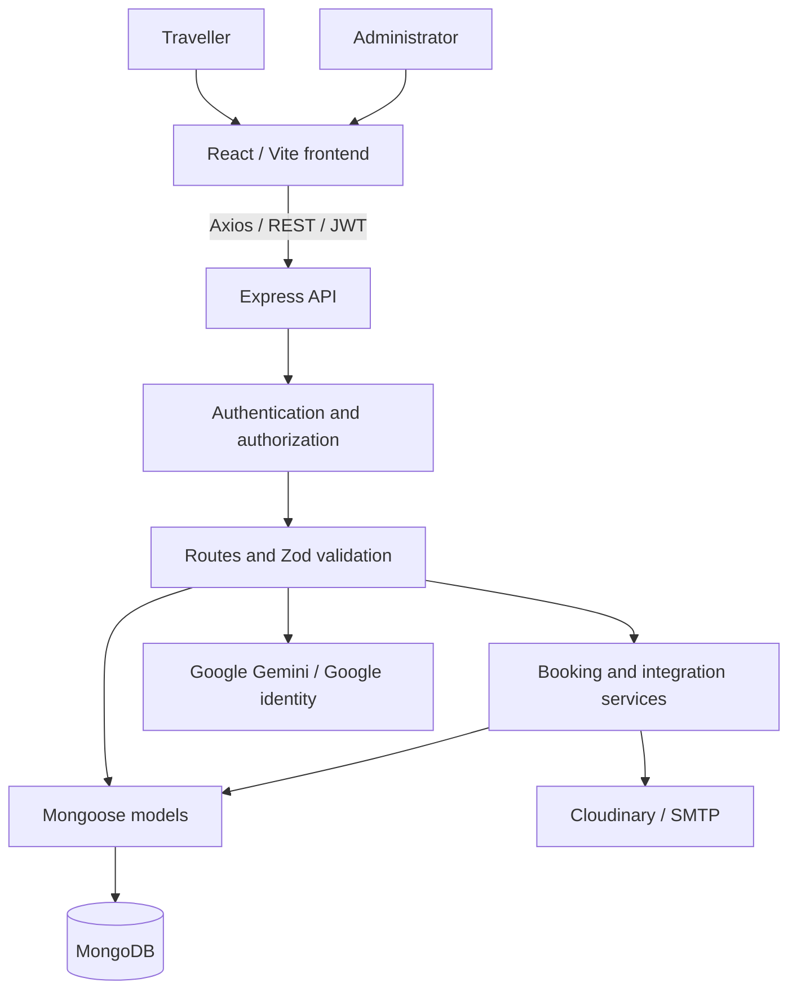

# Roamora

**Discover journeys. Build itineraries. Travel beyond your limits.**

A full-stack travel discovery, booking and AI-assisted itinerary planning platform built with the MERN stack.

[](https://react.dev/) [](https://vite.dev/) [](https://expressjs.com/) [](https://mongoosejs.com/) [](https://ai.google.dev/) [](https://roamoraa.netlify.app/)

[Live application](https://roamoraa.netlify.app/) · [API health](https://roamora-8niu.onrender.com/api/health) · [Source code](https://github.com/Rahim023/Roamora)


## Overview

Roamora brings travel discovery, package comparison, itinerary customization, booking management and AI-assisted planning into a single responsive application. A separate administrator workspace supports catalogue operations, departure inventory, customer management and booking analytics.

The project demonstrates frontend component design, REST API integration, authentication, transactional data handling, third-party integrations and deployment of a complete web application.

## Table of contents

- [Features](#features)
- [Technology stack](#technology-stack)
- [Architecture](#architecture)
- [Repository structure](#repository-structure)
- [Getting started](#getting-started)
- [Environment variables](#environment-variables)
- [API reference](#api-reference)
- [Data model](#data-model)
- [Engineering highlights](#engineering-highlights)
- [Testing](#testing)
- [Deployment](#deployment)
- [Limitations and roadmap](#limitations-and-roadmap)

## Features

### Traveller experience

- Discover travel packages through destination, travel type, budget, duration and currency filters, sorting and pagination.
- Explore package details, daily itineraries, departure schedules, reviews and interactive destination maps.
- Save favourite journeys and compare up to three packages side by side.
- Book available departures for multiple travellers and manage booking history and cancellations.
- Build personalized itineraries with drag-and-drop or keyboard-based activity reordering and calculated activity costs.
- Register with email and password or Google Sign-In; recover local accounts with email verification codes.
- Receive booking confirmations and review invitations; review eligible completed journeys.
- Explore animated landing pages, reusable interactive components and day/night themes.

### Travo — AI travel assistant

- Conversational trip discovery powered by Google Gemini.
- Grounding with active public packages, activities and upcoming departures.
- Dedicated authenticated itinerary planning endpoint with catalogue validation and budget calculations.
- Floating chat entry point and character-by-character response presentation.
- Rate-limited requests and server-side API key management.

### Administrator workspace

| Module | Capabilities |
| --- | --- |
| Overview | Booking-value trends, destination popularity, account and catalogue metrics, upcoming departures and recent bookings |
| Journeys | Create, edit and archive packages; upload cover images |
| Departures | Schedule departures, manage capacity and view occupancy calendars |
| Bookings | Inspect bookings, mark confirmed trips completed and retry eligible email notifications |
| Travellers | Manage account details, active status and roles |
| Activities | Create, update and remove catalogue activities |
| Reviews | Inspect and moderate reviews |
| Site content | Manage homepage content and destinations |

## Technology stack

| Layer | Technologies |
| --- | --- |
| Frontend | React 18, JavaScript ES modules, JSX, Vite 6, React Router, Axios |
| Styling | Bootstrap 5, CSS, styled-components |
| Motion and graphics | GSAP / ScrollTrigger, Motion for React, Three.js, OGL, adapted React Bits and CodePen components |
| Icons | Lucide React, Hugeicons |
| Maps | Leaflet, React Leaflet |
| Analytics | Recharts |
| Drag and drop | dnd-kit |
| Backend | Node.js, Express 5, REST APIs |
| Database | MongoDB, Mongoose 8 |
| Validation | Zod, Mongoose schema validation |
| Authentication | JWT, bcryptjs, Google OAuth integration and Google ID token verification |
| Security | Helmet, CORS, express-rate-limit, role-based authorization |
| AI | Google Gen AI SDK, Gemini |
| Media and email | Cloudinary, Multer, Nodemailer |
| Testing | Vitest, Supertest |
| Hosting | Netlify, Render |

## Architecture



The frontend uses shared components and client-side routing. The backend separates middleware, models, validators and services, with request handlers organized in the API router. Booking operations use MongoDB transactions to coordinate inventory and order updates.

## Repository structure

```text
Roamora/
├── frontend/
│   ├── src/
│   │   ├── components/
│   │   │   ├── AdventureHero.jsx
│   │   │   ├── TripMap.jsx
│   │   │   ├── Travo.jsx
│   │   │   ├── TravoBubble.jsx
│   │   │   ├── ReviewPage.jsx
│   │   │   └── ...
│   │   ├── App.jsx
│   │   ├── api.js
│   │   ├── auth.jsx
│   │   ├── main.jsx
│   │   └── styles.css
│   ├── package.json
│   └── vite.config.js
├── backend/
│   ├── scripts/
│   │   ├── bootstrapAdmin.js
│   │   ├── inspectCollections.js
│   │   └── compareModelSchemas.js
│   ├── src/
│   │   ├── config/
│   │   ├── middleware/
│   │   ├── models/
│   │   ├── routes/
│   │   ├── services/
│   │   ├── utils/
│   │   ├── validators/
│   │   ├── app.js
│   │   └── server.js
│   ├── README.md
│   └── package.json
└── readme.md
```

## Getting started

### Prerequisites

- Node.js 22 LTS or a compatible newer release and npm.
- MongoDB replica set or MongoDB Atlas (required for transactional booking and account updates).
- Google Gemini API key, Google OAuth web client, SMTP account and Cloudinary credentials for their respective integrations.

### Clone and install

```bash
git clone https://github.com/Rahim023/Roamora.git
cd Roamora
cd backend
npm ci
cd ../frontend
npm ci
```

Create `backend/.env` and `frontend/.env` manually using the configuration below. Do not commit these files.

### Run locally

Backend terminal (from repository root):

```bash
cd backend
npm run dev
```

Frontend terminal (from repository root):

```bash
cd frontend
npm run dev
```

Open `http://localhost:5173`. Check the backend at `http://localhost:5000/api/health`.

### Administrator setup

Set `ADMIN_EMAIL`, `ADMIN_PASSWORD` (at least 12 characters) and optionally `ADMIN_NAME` in the backend environment, then run:

```bash
cd backend
npm run admin:bootstrap
```

Sign in with the provisioned administrator account and visit `/admin`. Populate journey packages, activities and departures through the administrator workspace. No public administrator credentials are provided.

## Environment variables

### Backend — `backend/.env`

```dotenv
NODE_ENV=development
PORT=5000
CLIENT_ORIGIN=http://localhost:5173
MONGODB_URI=
MONGODB_DB_NAME=Roamora
JWT_SECRET=
GOOGLE_CLIENT_ID=
GEMINI_API_KEY=
GEMINI_MODEL=gemini-3.1-flash-lite
SMTP_HOST=
SMTP_PORT=587
SMTP_SECURE=false
SMTP_USER=
SMTP_PASS=
SMTP_FROM=
CLOUDINARY_CLOUD_NAME=
CLOUDINARY_API_KEY=
CLOUDINARY_API_SECRET=
ADMIN_EMAIL=
ADMIN_PASSWORD=
ADMIN_NAME=
```

### Frontend — `frontend/.env`

```dotenv
VITE_API_URL=http://localhost:5000/api
VITE_GOOGLE_CLIENT_ID=
```

Generate a strong private JWT signing secret. Configure matching Google client IDs and authorize the frontend origins in Google Cloud. `VITE_` variables are exposed in the client build; never put private keys or passwords there. Configure SMTP and Cloudinary only on the backend. Restart the services after changing environment variables.

## API reference

All routes are relative to `/api`. Protected routes require a valid bearer token; administrator routes additionally check the current account role and active status in the database.

| Method | Endpoint | Access / purpose |
| --- | --- | --- |
| GET | `/health` | Public — API health |
| POST | `/auth/register`, `/auth/login`, `/auth/google` | Public — authentication |
| GET / PATCH | `/auth/me` | User — profile |
| POST | `/auth/password-reset/request`, `/verify`, `/complete` | Public — password recovery (all under `/auth/password-reset`) |
| GET | `/packages`, `/packages/:id` | Public — catalogue |
| GET | `/packages/:id/departures`, `/packages/:id/reviews` | Public — availability and reviews |
| GET | `/activities`, `/site-content` | Public — activities and homepage |
| GET | `/wishlist` | User — saved trips |
| POST / DELETE | `/wishlist/:packageId` | User — save or remove a trip |
| POST | `/orders` | User — create booking |
| GET | `/orders/mine`, `/orders/:id` | User — bookings |
| POST | `/orders/:id/cancel` | User — cancel booking |
| PATCH | `/orders/:id/hide` | User — hide cancelled booking |
| GET | `/reviews/pending` | User — eligible reviews |
| POST / PATCH / DELETE | `/reviews`, `/reviews/:id` | User — create / edit / delete review respectively |
| GET / POST | `/itineraries` | User — list / create itineraries |
| PATCH / DELETE | `/itineraries/:id` | User — edit / delete itinerary |
| POST | `/itineraries/plan` | User — AI itinerary planning |
| POST | `/travo` | Public — AI travel chat |
| GET | `/dashboard/summary` | User — dashboard |
| GET | `/admin/analytics` | Admin — analytics |
| GET / POST | `/admin/packages`, `/admin/departures`, `/admin/activities` | Admin — catalogue management |
| PATCH / DELETE | `/admin/packages/:id`, `/admin/activities/:id` | Admin — edit / remove or archive |
| PATCH | `/admin/departures/:id` | Admin — departure updates |
| POST | `/admin/uploads/package-image` | Admin — image upload |
| GET | `/admin/orders`, `/admin/users`, `/admin/reviews` | Admin — operational records |
| PATCH | `/admin/orders/:id/complete`, `/admin/users/:id`, `/admin/users/:id/promote` | Admin — booking and account actions |
| POST | `/admin/orders/:id/email/retry`, `/admin/orders/:id/review-email/retry` | Admin — retry eligible notifications |
| DELETE | `/admin/reviews/:id` | Admin — moderation |
| PATCH | `/admin/site-content`, `/admin/site-content/destinations` | Admin — homepage updates |

Example catalogue request:

```bash
curl 'http://localhost:5000/api/packages?currency=CAD&maxPrice=200000&sort=popular&page=1&limit=6'
```

Price filters use integer minor currency units; `200000` represents CAD 2,000.00. Available search parameters include `q`, `destination`, `travelType`, `currency`, `minPrice`, `maxPrice`, `minDays`, `maxDays`, `sort`, `page` and `limit`.

## Data model

| Mongoose model | MongoDB collection | Responsibility |
| --- | --- | --- |
| User | `users` | Identity, roles and account state |
| Package | `package` | Travel catalogue |
| Departure | `departures` | Dates, capacity and inventory |
| Order | `orders` | Booking snapshots, status and notifications |
| Wishlist | `wishlist` | Saved packages |
| Review | `reviews` | Ratings and traveller feedback |
| Activity | `activities` | Activity catalogue and prices |
| Itinerary | `iteneraries` | Personalized travel plans |
| SiteContent | `sitecontents` | Homepage content |

Collection names intentionally preserve existing database naming, including `iteneraries`. Models bind explicitly to the corresponding collections.

## Engineering highlights

### Booking integrity

Booking creation requires an idempotency key to guard against repeated submissions. Transactional inventory updates reserve seats atomically and cancellation restores inventory. Order snapshots retain booking-time package and departure details. Monetary values use integer minor units with explicit currency codes.

### Security and identity

The backend verifies Google ID tokens, hashes local passwords with bcrypt, checks JWT validity and current account state, and enforces administrator permissions server-side. Password recovery uses single-use codes with a ten-minute lifetime and attempt limits. Helmet, CORS allowlists, request rate limits and Zod validation provide additional request protections. Account changes can invalidate existing sessions.

### AI grounding and privacy

Travo provides Gemini with bounded public catalogue context rather than private account or booking records. The itinerary planner validates suggested activities against catalogue data and computes group activity costs. AI suggestions may be incomplete; the chat is not persisted. The character animation is a presentation effect, not a claim of provider token streaming.

### Analytics and operational reliability

Recharts visualizes confirmed and completed booking values by UTC month and currency; cancelled and pending bookings are excluded. The administrator overview refreshes every 30 seconds. Email notifications run after booking confirmation, with delivery status and eligible retries, so SMTP delays do not block the booking response.

## Testing

Run the backend suite:

```bash
cd backend
npm test
```

The repository includes Vitest and Supertest coverage files for API routes, administrator authorization, booking services, schema models, AI planning, Travo, password recovery and email services.

Build the frontend:

```bash
cd frontend
npm run build
npm run preview
```

Frontend utility test files are present for booking trends, administrator display and destination images. The frontend package does not currently declare an npm test script.

Database diagnostic scripts (read-only):

```bash
cd backend
npm run db:inspect
npm run db:compare-models
```

## Deployment

| Service | Configuration |
| --- | --- |
| Netlify | Base directory `frontend`; build `npm run build`; publish `dist` relative to base |
| Render | Root directory `backend`; build `npm ci`; start `npm start` |
| MongoDB | Replica-set-enabled deployment with appropriate network access |

Set `VITE_API_URL=https://roamora-8niu.onrender.com/api` in Netlify and allow `https://roamoraa.netlify.app` in the backend `CLIENT_ORIGIN`. Configure SPA fallback routing on Netlify and the production OAuth authorized origin. Check `/api/health` after deployment.

See [backend documentation](backend/README.md), [deployment guide](DEPLOYMENT_GUIDE.md) and [Travo setup](TRAVO_SETUP.md) for further detail.

## Limitations and roadmap

- Roamora is a booking demonstration: it does not collect or transfer money. Booking-value charts do not represent received payments.
- Itinerary estimates include catalogue activity costs, not total travel expenses. No exchange-rate conversion is performed.
- AI answers can be incomplete or inaccurate; catalogue context is capped.
- Rate limits currently use an in-memory store. A shared store and correctly configured proxy trust are recommended for multi-instance deployments.
- Email delivery depends on SMTP configuration and provider availability; acceptance is not proof of inbox delivery.
- Potential future improvements: payment integration, broader frontend component and end-to-end testing, automated CI, and production observability.

## Author

**Abdul Rahim** — Full-stack developer

[GitHub](https://github.com/Rahim023) · [Developer portfolio](https://rahim23-portfolio.netlify.app/) · [Roamora live demo](https://roamoraa.netlify.app/)

### Acknowledgements

React Bits and CodePen for adapted UI inspiration, and the open-source libraries and external services listed above. Refer to their respective licenses and usage terms.

